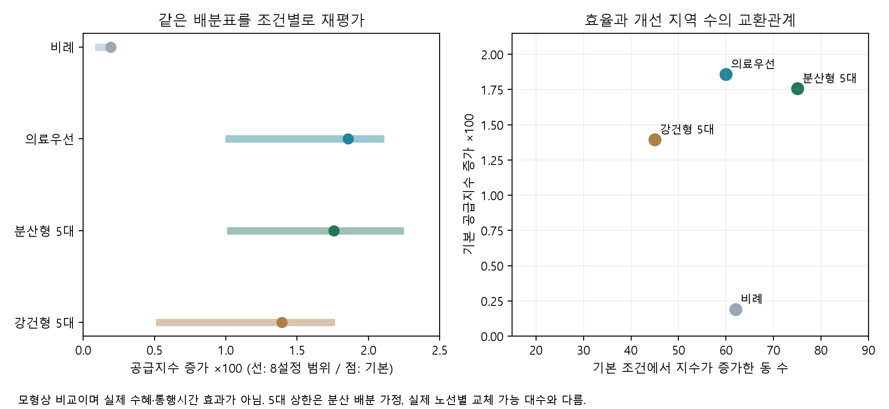

# 서울시 저상버스 교체 배분: 의료 연결과 지역 형평성

**2026 AI와 함께하는 교통문제 해결을 위한 데이터 분석 공모전** 분석·재현 저장소. 서울시 공개자료를 결합해 제한된 저상버스 교체 물량을 **어떤 노선에 배분할지** 비교한다. 교통 이용자의 실측 이동시간이나 실제 탑승효과를 예측하는 연구는 아니다.

## 공모전 제출 준비 (2026-10-18)

- [추가 장기 수집 없이 제출하는 핵심 분석 요약](docs/contest_submission_brief_20261018.md) — 50대 가상 교체·3/5/7대 상한·현장 검증 수준·일회성 차량 위치 관측의 한계
- **제출은 장기 운행 실측 완료에 의존하지 않는다.** 기존 정적 공급지수 모형의 정책 시뮬레이션을 주된 결과로 삼고, 2026-10-18 단일 시점 차량 위치 관측은 보조 참고로만 제시한다.
- 주최측의 공식 참가신청서·분석보고서 양식은 별도로 준수해야 한다.

## 연구 질문

> 50대의 고상버스를 저상버스로 교체한다면, 지수 개선을 집중하는 방법과 더 많은 행정동에 개선 기회를 배분하는 방법 사이에서 어떤 선택이 가능한가?

## 핵심 결과: 동일한 가상 교체 물량 50대

| 정책안 | 고령인구 가중 공급지수 증가 | 개선 동 수 | 배분 노선 수 | 한 노선의 최대 배분 |
|---|---:|---:|---:|---:|
| 예외노선 제외 비례 | 0.001908 | 62 | 50 | 1대 |
| 기존 의료연결 우선 | **0.018585** | 60 | 11 | 9대 |
| **분산형: 노선당 최대 5대** | **0.017573** | **75** | 15 | 5대 |
| 다중조건 강건형 | 0.013940 | 45 | 12 | 5대 |

분산형은 **기본 500m 모형에서** 기존 의료우선 대비 지수 개선량의 **94.56%**를 유지하면서 개선되는 행정동 수를 **60개 → 75개(+25%)**로 넓혔다. **이 비율은 모든 분석 조건에 성립하지 않는다.** 예컨대 300m 조건에서는 분산형의 증가량이 기존 의료우선보다 작다. 노선당 5대는 실제 배차·차고지 제약으로 입증한 값이 아니라 연구자가 설정한 집중도 상한이다.

## 추가 검증: 5대 상한만 선택해야 하는가?

| 한 노선당 교체 상한 | 기본조건 지수 증가 | 개선 동 수 | 기존 의료우선 증가량 유지율 | 0.05 이상 개선 동 |
|---|---:|---:|---:|---:|
| 1대 | 0.010289 | **174** | 55.4% | 11 |
| 3대 | 0.014944 | **102** | 80.4% | 45 |
| 5대 | 0.017573 | 75 | 94.6% | **51** |
| 7대 | 0.018202 | 61 | 97.9% | 45 |
| 10대/상한 없음 | 0.018585 | 60 | 100% | 46 |

상한이 낮을수록 더 많은 동의 지수가 증가하는 경향이 있으나, **작은 개선도 1개 동으로 세는 문제**가 있다. 그래서 0.01 이상·0.05 이상 개선된 동 수, 최초 지수가 낮은 하위 20% 동의 개선량, 고령인구 가중 개선량의 상위 지역 집중 비율도 함께 공개했다. **3대와 5대는 어느 쪽도 두 목표에서 일방적으로 우월하지 않다.** 본 결과는 동일 예산과 동일 후보 제약 하의 *탐욕 배분 시뮬레이션*이며 전역 최적해의 파레토 경계나 실제 시공 가능성을 증명하지 않는다.

추가로 5대 배분의 15개 노선을 하나씩 제외해 지수 변화에 영향을 주는 **99개 동–병원–노선 정적 조합**을 추렸다. 제한된 기존 69개 노선 조회 스냅샷 중 배분 노선 4개를 확인했고, 그 안의 30개 조사 조합 중 26개에서 병원행·귀가행의 정류장 순서가 모두 성립했다. 대표 예시로 **위례동–삼성서울병원(343번)**과 **천호1동–강동경희대학교병원(3413번)**에서 양방향 정류장 순서가 확인됐다. 2026년 10월 17일 취득 노선정보에 기재된 평일 일반 배차 간격은 각각 **15분·9분**이다. 이는 저상버스 전용 배차 간격이 아니다. 이는 **정적 경로 예시**일 뿐 실제 왕복 운행시간, 환승·보행 접근성 또는 저상버스 탑승을 검증한 결과가 아니다.

## 추가 검증: 공시 배차와 교체 제약이 결론을 바꾸는가?

기존 공급지수는 정적 노선 공유 여부와 2025년 저상버스 보유율만 사용한다. 이를 대체하지 않고 서울교통빅데이터플랫폼에서 **2026-10-17 취득한 일반 노선 공시 평일 배차 간격**을 이용해 **별도의 보조 지수**를 구축했다.

`보조지수(동–병원) = max[저상버스 보유율 × min(1, 기준간격 / 일반 공시 배차간격)]`

기준간격은 연구 가정인 **10·15·20분**을 비교한다. 2025 차량자료와 2026 노선정보를 혼합한다는 한계가 있으며, 노선 식별자가 불명확하거나 배차 정보가 없으면 0분 또는 임의 간격으로 채우지 않고 **관측범위 밖**으로 기록한다. 동일한 관측 가능 동–병원 쌍에서 기존 50대 배분표들을 **고정한 채** 비교한다. **실제 저상버스 운행 간격, 평균 대기시간, 병원 이동 소요시간을 추정한 지표가 아니다.**

분석 대상 294개 노선 중 **293개가 보수적인 노선명·노선ID·운행상태 조건으로 일치**했다. 고정한 50대 배분표에서 계산한 보조 지수 개선량은 다음과 같다. 모두 **배차 가중 보조 지수**이므로 앞서 제시한 원래 지수 개선량과 값 자체를 직접 비교하지 않는다.

| 배차 가중 기준 | 기존 의료우선 | 노선당 3대 | 노선당 5대 | 노선당 7대 |
|---|---:|---:|---:|---:|
| 10분 | **0.021313** | 0.018086 | 0.021098 | 0.017672 |
| 15분 | **0.025092** | 0.020648 | 0.023835 | 0.024028 |
| 20분 | **0.025137** | 0.020213 | 0.023769 | 0.024619 |

기존 의료우선은 위 가중 지수에서 가장 높았지만, **5대와 7대 상한의 상대 순위는 기준 10분과 15·20분 사이에서 뒤바뀌었다**. 정책의 효율을 특정 기준간격 하나로 단정하지 않아야 한다.

실행 가능성 검토에서는 2025년 잔여 고상버스 중 **25%·50%·100%만 가상으로 교체 가능하다**는 시나리오를 비교한다. 노선당 5대 제한과 공식 예외노선 제외를 유지하되 시나리오별로 배분을 다시 계산한다. 이 비율은 **실제 차령·차종·차고지·충전·예산 정보로 검증된 교체 가능 대수가 아니다.**

가상의 교체 가능 비율이 25%·50%·100%일 때 원래 정적 공급지수 증가량은 각각 **0.008668·0.012964·0.017573**, 개선 동 수는 **122·104·75개**였다. 모두 가상 50대 배분을 완료했지만, 제약이 커지면 더 넓고 얕은 개선이 나타났다. 실제 교체 가능 차량 물량을 검증한 수치는 아니다.

대표 노선은 실제 지수 변화에 기여하는 동–병원 조합을 우선하여 병원행과 귀가행의 정류장 순서 및 공시 배차를 각각 정리했다. [대표 2~3개 노선의 근거 표](medical/results/route_case_brief.md)에서 확인할 수 있다. 또한 작은 가상 문제 25개에서 탐욕 배분을 가능한 모든 조합의 정확해와 비교했다. 최악 사례는 정확해 개선량의 **97.38%**였으며 실제로 탐욕이 최적해보다 낮은 사례가 존재했다. 이는 **서울 전체의 최적성 검증이 아니라 소규모 예시**다.

검증 결과 CSV와 방법 설명은 [medical/README.md](medical/README.md), [배차 보조 지표](medical/headway_proxy.py), [교체 가능성 가정](medical/feasibility_assumptions.py), [소형 정확해 대조](medical/benchmark_greedy_small.py)에 공개한다. 완전 재현 후 [입출력 SHA-256 및 환경 기록](medical/results/validation_v2_receipt.json)으로 결과를 확인할 수 있다.



> **해석 범위:** 지수는 행정동 중심점과 병원 좌표에서 정적 공유노선의 **저상버스 보유율 최댓값**을 이용한 공급기회 지표이다. 실제 병원 접근 가능성, 저상버스 대기시간, 탑승 성공률, 실제 수혜 인구, 건강 결과를 뜻하지 않는다. 데이터 시점도 완전히 같지 않다.

## V3: 전체 분모·복수 노선 가정 검증

기존 보조지표는 공시 배차와 연결되는 동–병원 쌍만 다시 정규화하여 결과를 표시했다. V3에서는 **426개 동 × 가까운 종합병원 3곳 = 전체 1,278개 쌍**을 고정한 결과를 별도로 계산하고, 공유노선이 없는 쌍·직선 보행권 쌍·배차 연결 가능 쌍·배차정보 불명 쌍을 분리했다.

또한 동일한 50대 배분표를 유지하면서 **단일 공유노선 최댓값**과 **복수 노선 점수의 포화 합성**을 나란히 비교한다. 포화 합성은 모델 구조의 민감도 실험이지 실제 차량 도착·탑승 확률이 아니다.

- [V3 정책 판단 1페이지 요약](medical/results/v3_policy_brief.md) — 정책 효율·지역 확산·분모·모델 한계
- [전체 분모 및 복수 노선 검증 수치](medical/results/v3_denominator_multiroute.csv)
- [1,278개 동–병원 쌍의 분류](medical/results/v3_pair_classification.csv)
- [서울시 저상버스 운행 실측 자료 수집 프로토콜](medical/v3_service_data_protocol.md) — **실측 완료를 주장하지 않음**
- [V3 재현·감사 결과](medical/results/validation_v3_receipt.json)

실제 차량 유형·출발시각과 휠체어 접근 가능한 보행로는 공공 API 조회 및 현장조사가 필요하다. **현재 연구의 성과는 교체 노선 사전검토를 위한 정적 정책 시뮬레이션**으로 한정된다.

## V4: 추천 노선의 현장 검증 준비 상태

모델상 추천 노선을 **집행 가능한 사업으로 단정하지 않기 위해**, 노선별 근거와 미확보 증빙을 연결한 의사결정 게이트를 추가했다.

- [V4 정책·현장검증 요약](medical/results/v4_decision_brief.md) — 3·5·7대 상한의 성과·정적 방향 확인 범위·미검증 요건
- [모델상 기여하는 전체 동–병원 쌍의 방향별 검증](medical/results/v4_directional_pairs.csv) — 기존 69개 노선 스냅샷 범위의 분석이며, 확인 실패가 실제 운행 부재를 의미하지 않음
- [선택 노선 15개의 집행 증거 점검표](medical/results/v4_implementation_gates.csv) — 2025 차량 보유율·2026 공시 배차·왕복 정류소 순서와 실제 차령·배차·비용·접근성 미검증 구분
- [공식 서울시 버스위치 API를 위한 수집 도구](medical/v4_vehicle_snapshot.py) — 인증키 없는 기본 실행은 **조회 없는 점검 모드**, 실제 응답을 확보할 때만 별도 개인 작업 파일에 가명처리 기록
- [V4 입력·출력 감사](medical/results/validation_v4_receipt.json)

서울시 공공 API 문서상 차량유형 0=일반, 1=저상 정보가 있지만, **현재 이 저장소에 실제 차량별 정류소 도착·저상버스 탑승 기록은 없다**. 위치 응답과 실제 도착·탑승은 서로 다르다. 이번 결과는 여전히 교체 우선검토를 위한 분석이다.

## 한 번에 재현하기

Python 3.12에서 저장소 루트를 기준으로 다음을 실행한다. 원자료 스냅샷과 출처는 [medical/README.md](medical/README.md)에 있다.

```bash
python -m pip install -r requirements.txt
python medical/reproduce_all.py
```

전체 과정에는 원자료 정제, 의료연결 공급지수, 방향·환승 사례, 동일 배분표 8조건 검증, 노선 교체 불가 검증, **교체 상한 1·3·5·7·10대·무제한 비교**, **동별 형평성 보조지표**, **배분 추천 노선의 제한적 왕복 경로 파일럿**, 독립 재계산과 단위 테스트가 포함된다.

새로 추가된 스크립트의 출력은 실행 후 `medical/results/`에 생성된다.

| 새 출력 | 주요 내용 |
|---|---|
| `cap_equity_summary.csv` | 교체 상한별 지수 증가·개선 동 수·1/5%p 이상 개선 동·하위 지역 개선·집중도 |
| `cap_fixed_scenarios.csv` | **같은 배정표**를 8조건에서 평가한 값 |
| `cap_dong_changes.csv` | 426개 행정동별 개선량과 하위 20% 표시 |
| `cap_equity_comparison.png` | 효율·개선 범위 교환관계 도표 |
| `cap5_route_pilot_candidates.csv` | 보유한 69개 노선 스냅샷 안에서만 확인한 추천 노선의 방향별 사례 |
| `cap_equity_audit.json` | 새 결과의 재계산 점검 결과 |

왕복 경로 파일럿은 69개 과거 조회 노선으로 **범위가 제한**된다. 매칭에 실패해도 해당 지역에 실제 버스가 없다는 뜻이 아니다. 또한 공시 배차는 일반적인 노선 간격으로서 **저상버스 배차 간격이 아니다**.

## 분석 구성과 근거

- [의료 연결 분석·원자료 출처·가정·기존 8조건 검증](medical/README.md)
- [핵심 공유노선 지수 코드](medical/analyze_medical.py)
- [배분표 고정 검증](medical/decision_stress.py) 및 [공개 CSV](medical/results/fixed_allocation_stress.csv)
- [교체 상한 및 형평성 확장 코드](medical/policy_extension.py)
- [추천 노선이 실제 지수 변화에 기여하는 동–병원 쌍의 정적 반사실 비교](medical/route_marginal.py)
- [추천 노선 병원행·귀가행 제한적 확인](medical/allocated_route_pilot.py)
- [초기 저상버스 보유율 분석 전문](docs/initial_analysis.md) — 기존 분석은 삭제하지 않고 보존

**활용 제안:** 이 결과는 실행 명령이 아니라 후보 검토 근거다. 최신 차량별 대폐차·차량 규격 및 예외 승인 확인 → 병원행 실제 수요·왕복 시간대 → 보행·정류장 접근성 → 시범사업에서 실제 저상버스 탑승·대기·도착시간 측정이 추가로 필요하다.

