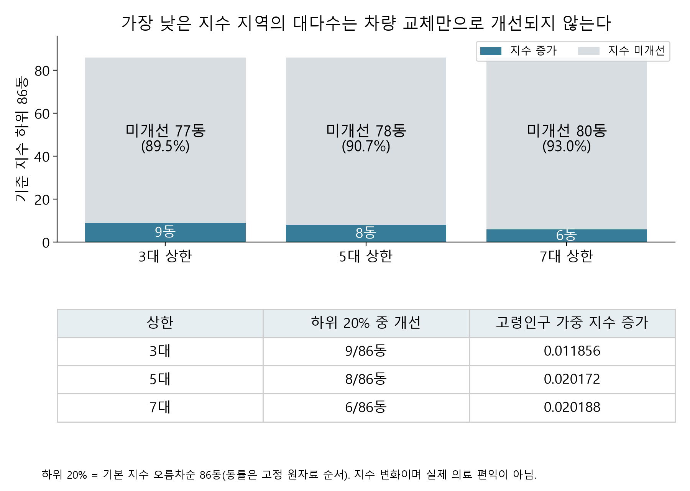
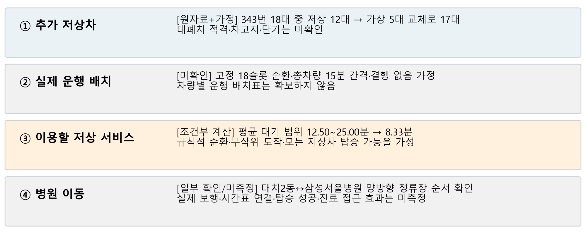

# 정책 제안: 5대 상한을 협의 출발안으로, 조건에 따라 3·7대 전환

## 기본 권고와 포기하는 성과

동일 가상 50대에서 **노선당 최대 5대안을 기본 협의안**으로 제안한다. 기본 공급지수 개선량의 94.6%를 유지하면서 75동을 개선하고, 0.05 이상 증가 동은 51개로 3·7대안의 45개보다 많다. 하위 20%의 가중 지수 증가도 7대안에 근접하면서 더 많은 하위 동(8개 대 6개)에 증가가 나타난다.

이는 **연구자가 사후 결과를 보고 선택한 절충 판단**이다. 공식 정책목표, 이해관계자가 합의한 선호, 사전 등록 기준 또는 검증된 실제 적격 물량이 아니다. 0.05는 기술적 비교 문턱이며 통계적 유의성 기준이 아니다.

5대안은 3대안보다 개선 동이 27개 적고(75 대 102), 하위 20% 개선 동도 1개 적다(8 대 9). 7대안보다 기본 지수 증가가 0.000628 작고, 병원 500m 수요 가중 증가도 10.355%p 대 12.528%p로 작다. 모든 목표의 최적안이라고 주장하지 않는다.

## 3·7대안으로 전환하는 조건

|합의해야 할 우선 목표|선택할 후보|포기하는 성과|
|---|---|---|
|기본값: 지수 효율과 0.05 이상 개선 범위를 절충|5대|3대보다 확산 범위 작음, 7대보다 지수·병원 인접 수요 지표 낮음|
|개선 동 수 또는 전체 승차 수요 가중 지표를 최우선|3대|기존 의료우선 대비 지수 개선량 유지율 80.4%; 0.05 이상 개선 45동|
|3·5·7대 중 기본 지수 증가 또는 병원 500m 승하차 가중 지표를 최우선|7대|개선 61동, 하위 20% 개선 6동으로 범위 축소|
|취약지역 대부분을 실제로 개선하거나 차량별 집행을 요구|현 안만으로 충족했다고 하지 않음|접근·노선 연결 대안 및 실제 집행 자료를 확인하고 재검토|

목표는 실제 정책 담당자·이용자와 정할 사항이다. 선호가 바뀌었는데도 연구자의 5대 선택을 고정하지 않는다. 차량별 대폐차 적격·차고지·충전·가격이 확인되지 않으면 구매·집행을 승인한 것으로 취급하지 않는다.

## 하위 20%에 대한 불리한 결과도 함께 공개

기준 지수 오름차순 86동(ceil(426×0.2), 동률은 기존 고정 순서)을 같은 집단으로 비교한다. 실제 소득·장애 정도에 따른 취약계층 분류가 아니다.

|상한|하위 86동 중 개선|미개선 비중|하위 집단 고령인구 가중 지수 증가|
|---|---:|---:|---:|
|3대|9|77/86 = 89.5%|0.011856|
|5대|8|78/86 = 90.7%|0.020172|
|7대|6|80/86 = 93.0%|0.020188|

5대안은 하위 집단 평균과 개선 지역 수를 모두 최대화하지 못한다. 특히 78동은 지수가 늘지 않으므로 ‘가장 불리한 지역 대부분이 혜택을 본다’고 말할 수 없다. [86동 전체 비교 및 5대안 미개선 표식](../medical/results/policy_equity_focus.csv)을 별도 접근·연결 검토 목록으로 사용한다. 미개선 원인을 모두 노선 부재로 단정하지 않고 대표점·반경·대상 병원·공유노선 구성부터 확인한다. 환승·보행·정류소 접근 개선은 대안 검토이지 이 분석에서 효과를 계산한 사업이 아니다.

## 추가 차량이 실제 의료 편익이 되기까지: 343번 예시

1. **추가 저상차:** 2025 보유자료의 인가 18대·저상 12대에 5대 가상 교체를 적용하면 17/18이다. 실제 대폐차 가능 대수는 미확인이다.
2. **운행 배치:** 18개의 고정 운행 슬롯, 2026.10.17 취득 일반 공시 간격 15분, 규칙적 순환·결행 없음으로 가정한다. 18대가 모두 동시에 동일 패턴으로 운행함을 확인한 것은 아니다. 실제 배치표가 없다.
3. **이용 가능한 저상 서비스:** V10 조건부 모형에서 저상 슬롯의 배열에 따른 평균 대기 범위는 12.50~25.00분에서 8.33분이 된다. 도착이 균일하고 모든 저상차가 탑승 가능하다는 가정이다. 실제 시간 절감, 실제 배차·대기 추정 또는 신뢰구간이 아니다.
4. **병원 이동:** 대치2동↔삼성서울병원 양방향 정류장 순서는 보관된 노선정보로 확인했다. 실제 보행, 차량 수용력, 휠체어 탑승, 진료시간 연결 및 의료 편익은 미측정이다.

따라서 기본 제안은 **5대안을 협의 출발안으로 삼고, 하위 78개 미개선 동의 연결·접근 보완을 별도 검토하며, 운행 배치와 실제 탑승을 확인한 뒤 편익을 판단하는 것**이다. 별도 보완 사업의 물량·비용·효과를 가상 50대 결과에 합산하지 않는다.

근거: medical/results/cap_equity_summary.csv, cap_dong_changes.csv, historical_ridership/v3_spatial_policy_summary.csv, route_case_brief.md, v10/v10_conditional_wait_bounds.csv 및 medical/v10_conditional_wait.py. 새로운 배분 최적화나 현장 관측을 추가한 것이 아니다.
